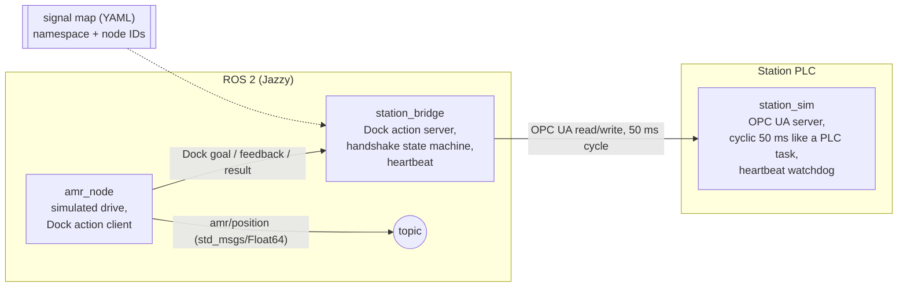
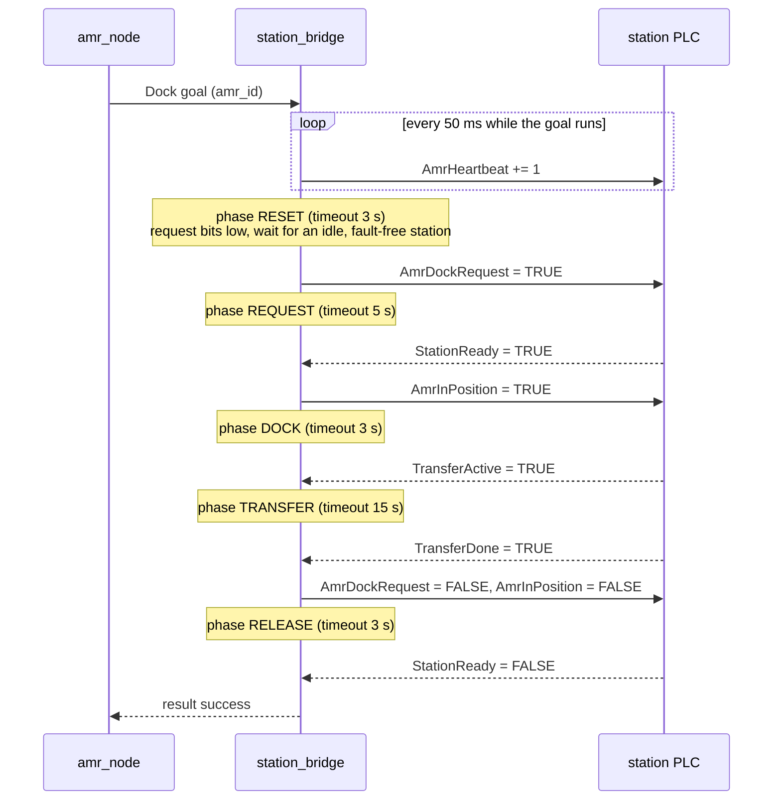
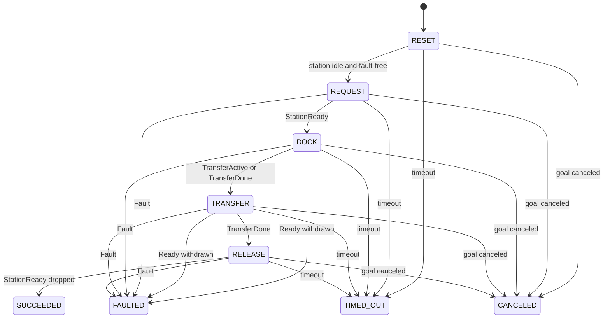

# Architecture

A mobile robot (AMR) drives to a conveyor station and hands over a load. The
robot lives in ROS 2, the station is a PLC. Neither side trusts the other to
behave: every step of the handover is a signal exchange with a timeout, the
station watches a heartbeat from the robot side, and any silence, fault or
withdrawn signal ends the handover with the robot's request dropped.

## Components

| Package | Type | Contents |
|---|---|---|
| `amr_handshake_interfaces` | ament_cmake | `Dock.action` |
| `amr_station_handshake` | ament_python | `handshake.py` (pure state machine), `station_bridge.py`, `amr_node.py`, `station_sim.py`, signal maps, launch file, tests |

`handshake.py` imports neither ROS nor OPC UA. The decision logic can be unit
tested in milliseconds, and the same logic could be ported 1:1 to a PLC
function block because it is written the same way: read inputs, step once,
write outputs.

## Signals

Every signal is a plain `BOOL` or `INT` (OPC UA `Boolean` / `Int16`), so the
list maps directly onto a PLC data block or a TwinCAT `GVL`.

| Signal | Type | Direction | Meaning |
|---|---|---|---|
| `AmrDockRequest` | BOOL | AMR → station | Robot wants to hand over a load |
| `AmrInPosition` | BOOL | AMR → station | Robot is docked, transfer may start |
| `AmrHeartbeat` | INT | AMR → station | Incremented every bridge cycle (50 ms), wraps at 32767 |
| `StationReady` | BOOL | station → AMR | Station accepts the handover; stays TRUE until the request drops |
| `TransferActive` | BOOL | station → AMR | Conveyor is moving the load |
| `TransferDone` | BOOL | station → AMR | Load is on the station |
| `Fault` | BOOL | station → AMR | Station fault; latched, cleared when the request drops (acknowledge) |
| `FaultCode` | INT | station → AMR | 0 = none, 1 = conveyor blocked, 2 = AMR heartbeat lost |

### Where the signals live: the signal map

The bridge never hard-codes node IDs. A YAML file names the namespace URI and
the node ID of each signal; the bridge resolves the namespace index at connect
time and fails with a clear error if the namespace or a signal is missing.

| File | Target |
|---|---|
| `config/station_sim.yaml` | Bundled simulator (default) |
| `config/s7_1500.example.yaml` | Siemens S7-1500, standard SIMATIC server interface, `"DB_Handshake"."…"` |
| `config/twincat3_tf6100.example.yaml` | Beckhoff TwinCAT 3 with TF6100, `GVL_Handshake.…` |

The two PLC maps are starting points, not tested against hardware: node IDs
depend on the project, so browse the server with UaExpert and copy them.

## Handshake

State machine in `handshake.py`:

Rules that hold in every phase:

1. **RESET first.** A fault latched by an earlier, failed handover must not
   block the next one forever. With both request bits low the station clears
   its fault (that is the acknowledge), so RESET waits for an idle station
   instead of failing on the stale fault. If it does not clear, the goal times
   out with the fault code in the error.
2. **After RESET, a fault wins.** `Fault` is checked before anything else.
3. **Terminal means hands off.** In `SUCCEEDED`, `TIMED_OUT`, `FAULTED` and
   `CANCELED` both AMR signals are FALSE. The bridge also writes them FALSE in
   a `finally`, so an exception in the middle of a transfer never leaves a
   request latched on the PLC.
4. **Each phase has its own timeout**, measured from entering that phase, not
   from the start of the goal.
5. **One goal at a time.** The action server rejects a second goal while a
   handover is running, and only accepts the next one after the first goal's
   status is set.

## Heartbeat and watchdog

The `finally` in rule 3 only runs while the bridge process is alive. If it is
killed, or the network goes away, nobody writes the request bits low. The
station therefore watches `AmrHeartbeat`: while `AmrDockRequest` is TRUE and
the counter has not changed for 1 s, it stops the transfer and latches
`Fault` with code 2.

The other direction needs no heartbeat. A dead station either breaks the
OPC UA session, which ends the goal as `link_error`, or stops answering,
which the phase timeouts catch.

## Link errors

The bridge treats OS errors, timeouts, OPC UA status errors and a missing
namespace as "the link is broken": the goal ends as `link_error` and the next
goal reconnects. Any other exception is a bug and is not caught, so it shows
up in the log instead of hiding behind a connection message.

## Threading

`station_bridge` runs a `MultiThreadedExecutor` and puts the action server in
a `ReentrantCallbackGroup`. The execute callback blocks in its 50 ms loop, and
the reentrant group keeps cancel requests flowing while it does. The OPC UA
client is asyncua's synchronous wrapper on one shared `ThreadLoop`, so the
ROS side stays plain synchronous Python.

## Station simulator scenarios

`station_sim --scenario ...` exists so every failure path can be shown and
tested without hardware.

| Scenario | Station behaviour | Handover ends |
|---|---|---|
| `normal` | Ready after 0.5 s, transfer takes 2 s | `succeeded` |
| `never_ready` | Ignores the request | `timed_out` in `request` |
| `fault_during_transfer` | Faults with code 1 halfway through the transfer | `faulted` |
| `crash_during_transfer` | Process exits halfway through the transfer | `link_error` |
| any, heartbeat stops | Faults with code 2 after 1 s | `faulted` |

## Relation to handover standards

The signal sequence borrows its shape from established load handover
interfaces between vehicles and stations, above all SEMI E84 (parallel I/O
handoff in semiconductor fabs): a request from the vehicle, a ready from the
station, a busy phase while the load moves, a completion, and a separate
timeout for each step. VDI 2510 covers driverless transport systems more
broadly.

It deliberately does not copy E84: there are no carrier IDs, no hand-off
availability signal, no separate load and unload requests, and the signals
travel over OPC UA instead of parallel I/O through an optical coupler.

## Verification

Nothing is verified by hand. GitHub Actions runs in the `ros:jazzy-ros-base`
container on every push:

1. `colcon build` of both packages.
2. `test_handshake.py`: unit tests for every transition, timeout, fault,
   reset and cancel path of the pure state machine.
3. `test_flake8.py`, `test_pep257.py`: ament code style and docstring checks.
4. `test_demo_launch.py`: `launch_testing` with real processes.
   - A normal station plus an AMR running two missions must exit 0.
   - A station that faults, one that never answers and a cancel during the
     transfer must each end the goal correctly **and** leave both request
     bits FALSE when read back from the station over OPC UA.
   - A station process that crashes mid-transfer must end the goal as
     `link_error`.
   - A station whose heartbeat stops must fault with code 2 and clear the
     fault once the request drops.
5. The Codespaces container image builds.

## Plan

| Phase | Deliverable | Status |
|---|---|---|
| 0 | Repo skeleton, licence, CI | done |
| 1 | `Dock.action`, `handshake.py`, unit tests | done |
| 2 | `station_sim`, `station_bridge`, `amr_node`, `demo.launch.py` | done |
| 3 | `launch_testing` integration tests | done |
| 3a | Hardening: signal map, heartbeat watchdog, RESET phase, released-bit checks, linters, Codespaces | done |
| 4 | Station as a PLC function block (TIA Portal SCL), same phases and watchdog | next |
| 5 | OPC UA subscriptions instead of polling | open |
| 6 | Run against a real soft-PLC (TwinCAT 3 or PLCSIM Advanced) | open |
| 7 | `amr_node` in C++ (`rclcpp`), browser demo page | open |

## Deliberately left out

- **Safety.** Nothing here protects people. On a real station the conveyor
  may only start when the station's own sensor sees the AMR docked, the
  transfer opening is guarded (for example a light curtain with muting), and
  those interlocks are wired into a safety PLC. OPC UA over WLAN coordinates
  the handover; it is not an interlock.
- **Gazebo, Nav2, maps, lidar.** Driving is a 1-D position ramp. Navigation is
  a solved problem with its own stack; the handover to a machine is the part a
  plant integrator owns.
- **VDA 5050 / fleet manager.** One robot, one station. A fleet manager would
  sit above the bridge and send the same Dock goal.
- **OPC UA security.** The simulator listens on 127.0.0.1 without encryption.
  A real station would use a signed and encrypted endpoint with certificates.
- **Polling.** The bridge reads five variables every cycle. Subscriptions
  would cut the traffic; for one station at 50 ms it is not worth the extra
  code yet.
