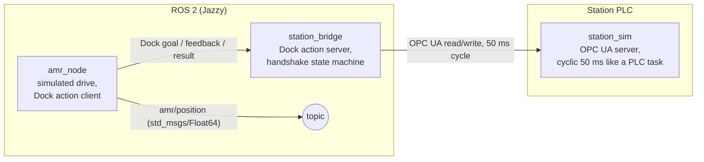
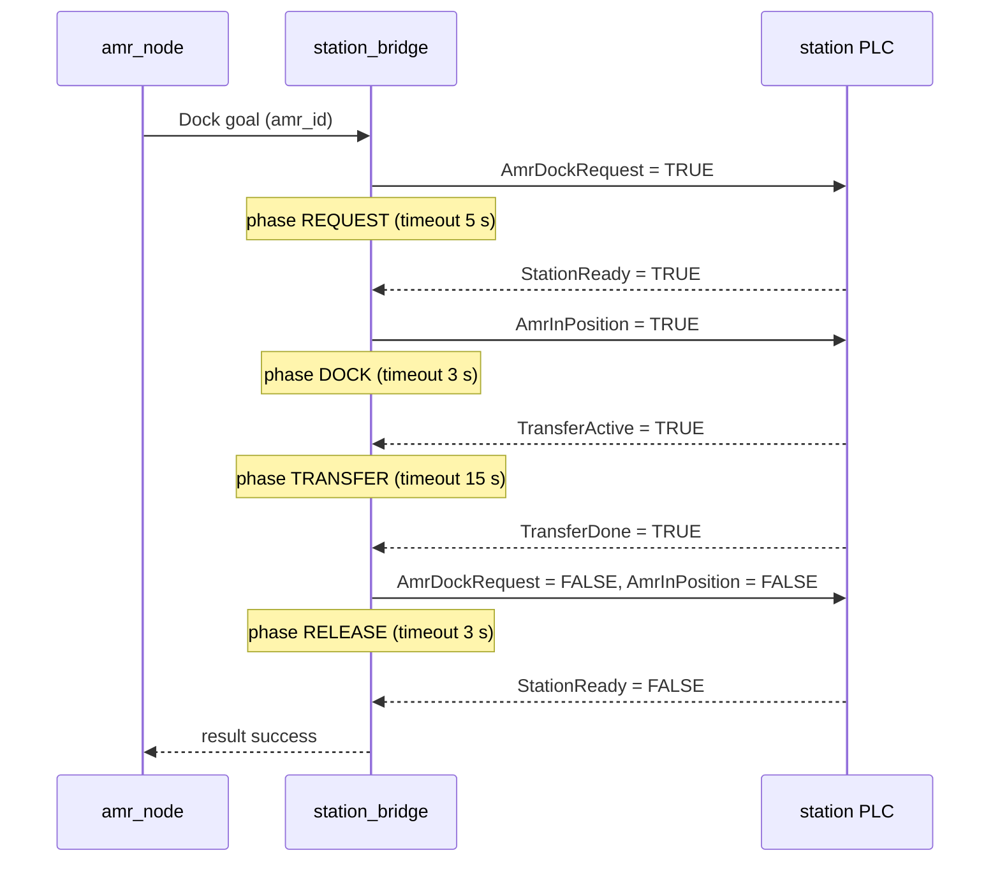
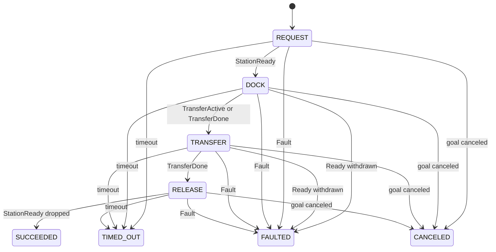

# Architecture

A mobile robot (AMR) drives to a conveyor station and hands over a load. The
robot lives in ROS 2, the station is a PLC. Neither side trusts the other to
behave: every step of the handover is a signal exchange with a timeout, and
any silence, fault or withdrawn signal ends the handover with the robot's
request dropped.

## Components

| Package | Type | Contents |
|---|---|---|
| `amr_handshake_interfaces` | ament_cmake | `Dock.action` |
| `amr_station_handshake` | ament_python | `handshake.py` (pure state machine), `station_bridge.py`, `amr_node.py`, `station_sim.py`, launch file, tests |

`handshake.py` imports neither ROS nor OPC UA. The decision logic can be unit
tested in milliseconds, and the same logic could be ported 1:1 to a PLC
function block because it is written the same way: read inputs, step once,
write outputs.

## Signals

The station is addressed as `ns=<urn:amr-station-handshake:station>;s=Station.<Name>`.
Every signal is a plain BOOL or INT, so the list maps directly onto a PLC's
I/O image or a TwinCAT `GVL`.

| Signal | Type | Direction | Meaning |
|---|---|---|---|
| `AmrDockRequest` | BOOL | AMR → station | Robot wants to hand over a load |
| `AmrInPosition` | BOOL | AMR → station | Robot is docked, transfer may start |
| `StationReady` | BOOL | station → AMR | Station accepts the handover; stays TRUE until the request drops |
| `TransferActive` | BOOL | station → AMR | Conveyor is moving the load |
| `TransferDone` | BOOL | station → AMR | Load is on the station |
| `Fault` | BOOL | station → AMR | Station fault; cleared when the request drops (acknowledge) |
| `FaultCode` | INT | station → AMR | 0 = none, 1 = conveyor blocked |

## Handshake

State machine in `handshake.py`:

Rules that hold in every phase:

1. **A fault wins.** `Fault` is checked before anything else.
2. **Terminal means hands off.** In `SUCCEEDED`, `TIMED_OUT`, `FAULTED` and
   `CANCELED` both AMR signals are FALSE. The bridge also writes them FALSE in
   a `finally`, so a crash in the middle of a transfer never leaves a request
   latched on the PLC.
3. **Each phase has its own timeout**, measured from entering that phase, not
   from the start of the goal.
4. **One goal at a time.** The action server rejects a second goal while a
   handover is running.

## Threading

`station_bridge` runs a `MultiThreadedExecutor` and puts the action server in
a `ReentrantCallbackGroup`. The execute callback blocks in its 50 ms loop, and
the reentrant group keeps cancel requests flowing while it does. The OPC UA
client is asyncua's synchronous wrapper on one shared `ThreadLoop`, so the
ROS side stays plain synchronous Python.

## Station simulator scenarios

`station_sim --scenario ...` exists so every failure path can be shown and
tested without hardware.

| Scenario | Station behaviour | Expected handshake result |
|---|---|---|
| `normal` | Ready after 0.5 s, transfer takes 2 s | `SUCCEEDED` |
| `never_ready` | Ignores the request | `TIMED_OUT` in `REQUEST` |
| `fault_during_transfer` | Raises `Fault`, code 1, halfway through the transfer | `FAULTED` |

## Verification

Nothing is verified by hand. GitHub Actions runs in the `ros:jazzy-ros-base`
container on every push:

1. `colcon build` of both packages.
2. `test_handshake.py`: unit tests for every transition, timeout, fault and
   cancel path of the pure state machine.
3. `test_demo_launch.py`: `launch_testing` integration test that starts real
   processes. A normal station plus a full AMR mission must exit with code 0,
   and a faulty station must make a Dock goal come back aborted with the
   fault reported.

## Plan

| Phase | Deliverable | Done when |
|---|---|---|
| 0 | Repo skeleton, licence, CI building empty packages | CI green |
| 1 | `Dock.action`, `handshake.py`, unit tests | Unit tests green in CI |
| 2 | `station_sim`, `station_bridge`, `amr_node`, `demo.launch.py` | Package builds, nodes start in CI |
| 3 | `launch_testing` integration test (normal mission, faulty station) | Integration test green in CI |
| 4 | README with run instructions, browser demo page on GitHub Pages | Demo page shows the handshake without installing anything |
| 5 | `amr_node` ported to C++ (`rclcpp`) | C++ node passes the same integration test |
| 6 | Station on a real soft-PLC: the handshake as an ST function block in TwinCAT 3 | Bridge completes a handover against TwinCAT instead of the simulator |

Phases 0–3 are the core. 4–6 each stand on their own.

## Deliberately left out

- **Gazebo, Nav2, maps, lidar.** Driving is a 1-D position ramp. Navigation is
  a solved problem with its own stack; the handover to a machine is the part a
  plant integrator owns.
- **VDA 5050 / fleet manager.** One robot, one station. A fleet manager would
  sit above the bridge and send the same Dock goal.
- **OPC UA security.** The simulator listens on 127.0.0.1 without encryption.
  A real station would use a signed and encrypted endpoint with certificates.
